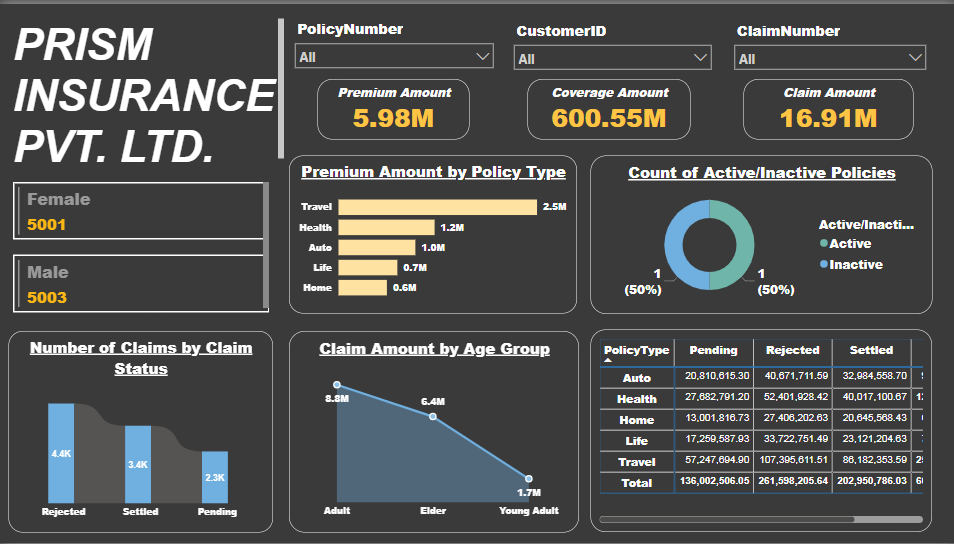

# Insurance Claims Analysis — Power BI

A one-page interactive Power BI dashboard for a fictional insurer, **PRISM Insurance Pvt. Ltd.** It shows premiums, coverage and claims across 10,000 policies, and looks at how claims split by status, policy type and customer age group.

🔗 **[View the live interactive report](https://app.powerbi.com/view?r=eyJrIjoiOTc0N2NhOGItYzc2My00ODFjLWE5ZWQtMjQ4OWNiMjY1Zjc5IiwidCI6IjQyMGVjNTg5LWE4NjYtNGFkMC05YTU3LWU2MDQ5ZTBkM2JjMCIsImMiOjh9)** (opens in the browser, no login needed)



## Business questions
- How much premium do we collect, and how much coverage and claim value do we carry?
- Which policy types bring in the most premium?
- How many claims are settled, pending or rejected?
- Which customer age groups claim the most?

## Tools
- **Power BI Desktop & Service** – data model, calculated columns, report, published to the web

## Data
`data/insurance_data.csv` – 10,004 rows, one row per policy and its claim (policies from 2024–2025)

| Column | Example |
|---|---|
| PolicyNumber, CustomerID, ClaimNumber | P1, C1, C1 |
| Gender, Age | Female, 73 |
| PolicyType | Auto, Health, Home, Life, Travel |
| PolicyStartDate, PolicyEndDate | 13-02-2024, 13-02-2025 |
| PremiumAmount, CoverageAmount | 240.64, 33,175.10 |
| ClaimDate, ClaimAmount, ClaimStatus | 22-06-2024, 1,493.06, Pending |

In Power BI I added two calculated columns: **Age Group** (Young Adult, Adult, Elder) and **Active/Inactive** policy status.

## Dashboard
- **KPI cards:** Premium Amount (5.98M), Coverage Amount (600.55M), Claim Amount (16.91M)
- **Customers by gender:** 5,001 female, 5,003 male
- **Premium by policy type:** bar chart
- **Number of claims by claim status:** ribbon chart
- **Claim amount by age group:** line chart
- **Active vs inactive policies:** donut chart
- **Coverage by policy type and claim status:** matrix
- **Slicers:** Policy Number, Customer ID and Claim Number, to look up a single policy or customer

A PDF export is in [`powerbi/Insurance_Claims_Report.pdf`](powerbi/Insurance_Claims_Report.pdf).

## Key findings
- **Travel** brings in the most premium (about 2.5M of 5.98M). This is because it has the most policies (41%). The average premium is about the same (≈600) for every policy type.
- **43.5% of claims are rejected**, 33.8% are settled and 22.6% are still pending. This mix is almost the same for every policy type, so no single product has a worse claims process.
- The total claim amount (16.91M) is made up of **settled claims (10.1M)** and **pending claims (6.8M)**. Rejected claims carry no amount.
- **Adults** have the highest total claim amount (8.8M), followed by Elders (6.4M). **Young Adults** have the lowest (1.7M).

## Data quality checks
- **4 duplicate rows** (policies P1, P2 and P4 repeat), so the file has 10,004 rows for 10,000 policies. These slightly inflate the totals and gender counts and should be removed.
- **Rejected claims** have no claim date and a claim amount of 0. That's expected, but they need to be left out of any "average claim amount" measure, or they'll drag it down.
- **Active/Inactive donut:** the visual counts the status *categories* (1 Active, 1 Inactive) rather than the number of policies, so it shows 50/50. It should use a count of PolicyNumber instead.

## Repository structure
```
├── powerbi/   Insurance_Claims_Report.pbix, Insurance_Claims_Report.pdf
├── data/      insurance_data.csv
└── images/    dashboard.png
```

## How to open
Use the **live report link** above. The `.pbix` file is a report connected to a dataset in the Power BI Service, so it won't load data in another person's Power BI Desktop. The screenshot, PDF and live link show the full result.

---
**Author:** Vaishali Kedare · [LinkedIn]([https://ie.linkedin.com/in/vaishalikedare](https://www.linkedin.com/in/vaishali-kedare-8a8b67215)) · [GitHub](https://github.com/vaishalikedare)
